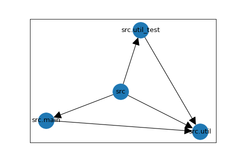
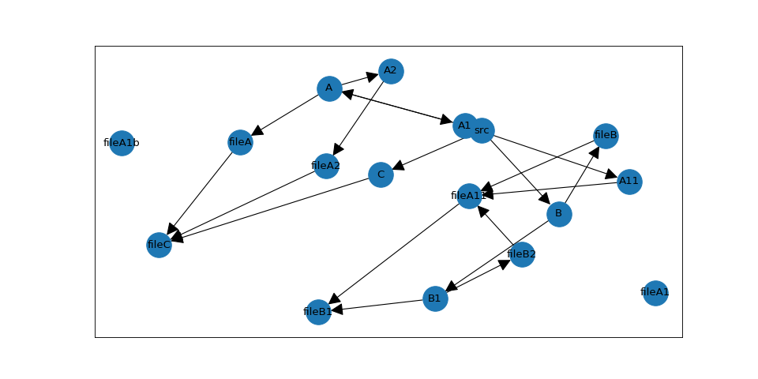

# General Concept
PyTestArch creates an Abstract Syntax Tree for each Python file it scans. It then extracts only the information about 
module imports from the AST and converts them to an internal representation. This is currently a graph supplied by the 
[NetworkX](https://networkx.org/) library.

When the user defines a rule and evaluates the internal representation against it, the rule is converted into a set of
graph operations that are then carried out on the previously generated graph.

## Generating the evaluable architecture representation
When scanning and processing the requested modules, PyTestArch executes the following step:
1) Parse all files starting at the requested `module_path`. This only takes python source files into account that are not excluded. By default, paths matching `*__pycache__*` are excluded; pass `exclusions=()` to disable that default.

2) Convert the generated AST into custom dependency representations. In this step, it is ensured that all internal modules (either importing or imported) receive their fully 
qualified name.

3) Generate a list of all modules that were parsed. This list is used to differentiate between external and internal dependencies (external dependencies will not have been parsed).

4) If not requested otherwise, external dependencies will be filtered out.

5) If external dependencies should be included, they will be added to the list of modules.

6) The dependency representations are converted to a graph structure.


## Simple Example

### Parsing all files
Consider the following project structure:
```
my_project/
    src/
        main.py
        util.py
        util_test.py
```

Both `main.py` and `util_test.py` are importing a util function defined in `util.py`; no other imports exist.

With `get_evaluable_architecture("/home/my_project/src")`, the `src` folder is the root and everything below it is
scanned. This creates the following graph:



Each module has a direct path to all submodules, in this case: "src" is connected to all three modules it contains, 
"src.main", "src.util", and "src.util_test".

In addition, a module that imports another module has a directed edge linking it to this module. For example, "src.main"
imports "src.util" and therefore the graph has an edge connecting these modules, with the arrow head pointing at the imported
module, in this case "src.util".

### Excluding some files

In the example above, the `util_test.py` file is included in the graph and will be considered when evaluating the architecture.
If certain files should be excluded from the analysis, this can be done by specifying an exclusion pattern. In our example,
if we want to exclude `util_test.py`, we could use:
```python
from pytestarch import get_evaluable_architecture

evaluable = get_evaluable_architecture(
    "/home/my_project/src",
    exclusions=(),
    regex_exclusions=(r".*_test\.py",),
)
```
This will exclude all files with names ending in "_test.py". It is also possible to exclude directories.


## More complex example
As a basis for describing the query language, let's consider a more complex example:
```
/test_project
    /src
       __init__.py
       /A
            __init__.py
            fileA.py
            /A1
                __init__.py
                fileA1.py
                fileA1_b.py
                /A11
                    __init__.py
                    fileA11.py
            /A2
                __init__.py
                fileA2.py
       /B
            __init__.py
            fileB.py
            /B1
                __init__.py
                fileB1.py
                fileB2.py
       /C 
            __init__.py
            fileC.py
```

With the following list of imports:
<ul>
    <li>fileA imports fileC</li>
    <li>fileA11 imports fileB1</li>
    <li>fileA2 imports fileC</li>
    <li>fileB imports fileA11</li>
    <li>fileB2 imports fileA11</li>
    <li>fileC imports the built-in os module</li>
</ul>

With `get_evaluable_architecture("/test_project/src")`, this creates the following graph (excluding all
`__init__.py`):



The module names in the diagram have been abbreviated: for example, the node "fileA" is actually named
"src.A.fileA" because `src` is the root.

Most of the edges in this graph are due to parent-child relationships between the modules. However, five of the six import
relationships defined above are present in the graph - only fileC has no connection to an "os" node; in fact, there is no
node named "os" at all.

This has been achieved by setting the `exclude_external_libraries` flag in the `get_evaluable_architecture` function. All modules
that are not located hierarchically below the root path, in this case `src`, will be excluded from the graph.

### Module not found in graph
If a rule references a module that does not appear in the dependency graph, PyTestArch raises a `ModuleUnknown` error with an actionable message. Common causes are:

- **External library excluded**: the module belongs to a third-party package and `exclude_external_libraries=True` (the default). Pass `exclude_external_libraries=False` to `get_evaluable_architecture()` to include it.
- **Module never imported**: the module exists but is not imported by any code under the scanned `module_path`, so it was never added to the graph.
- **Misspelled module name**: module names in rules must match the fully qualified import name (e.g. `mypackage.service`, not `service`).

## root_path vs. module_path in get_evaluable_architecture
`root_path` defines module names and the outer scan bound. `module_path` defines which part of the project is
scanned; only modules below it form the internal set. It defaults to `root_path`. So
`get_evaluable_architecture("src")` scans everything below `src` and treats everything else as external.

In a partial scan (`module_path` below `root_path`), packages outside `module_path` stay external even if they
are below `root_path`. This is deliberate: rules should not silently depend on modules that were not scanned.

### Choosing the scan root
For import-name scans, `root_path` is usually the directory that is on `sys.path`, not the repository root:

| Layout | Recommended call | Resulting names |
| --- | --- | --- |
| One top-level package | `get_evaluable_architecture("app", mode="multi_module")` | `app.module` |
| Several packages in one directory | `get_evaluable_architecture("src", mode="multi_module")` | `packageA.module` |
| Several projects with project metadata | `get_evaluable_architecture("mono", mode="multi_module")` | `svc_a.src.svc_a.api` |
| Unmarked projects | `get_evaluable_architecture("mono", mode="multi_module", import_roots=(...))` | `svc_a.src.svc_a.api` |
| Namespace packages | `get_evaluable_architecture_for_module_objects([...], mode="multi_module")` | full import names, e.g. `company.product.a.x` |

Passing a repository root that contains a single `src` project is supported: imports inside `src` are resolved
against the local `src` root, but names keep the `src` prefix (`src.app.module`). To drop the prefix, pass `src`
itself. For a monorepo, keep the repository root so project directories stay in the names and same-named
packages remain distinct.

For an unmarked monorepo, list its import roots explicitly. Only directories that directly contain packages or `.py` modules
belong in the list: the project directory for a flat layout, or its `src` folder for a source layout.

```python
get_evaluable_architecture(
    "mono",
    mode="multi_module",
    import_roots=("svc_a/src", "svc_b/src", "shared"),
)
```

## Scan modes
Both entry points accept the keyword-only option `mode="legacy"` (the default) or `mode="multi_module"`.
The mode selects naming and import resolution together:

| Root | `mode="legacy"` | `mode="multi_module"` |
| --- | --- | --- |
| Package root (has `__init__.py`) | Package name as prefix | Same |
| Container root (no `__init__.py`) | Directory name as prefix (`src.packageA`) | Path relative to the root (`packageA`) |

```python
get_evaluable_architecture("src")  # src.packageA.moduleA
get_evaluable_architecture("src", mode="multi_module")  # packageA.moduleA
```

`multi_module` additionally resolves imports written relative to an import root (see below); legacy mode treats
them as external. Use `multi_module` for new multi-package and monorepo scans, and legacy mode only to keep
existing rule names unchanged.

A container root is not a graph node in a multi-module path scan, so scanning the container itself with
`level_limit=1` retains only the top-level packages (`level_limit=0` is rejected there). Legacy mode counts the
directory-name prefix as the first level. With dotted namespace roots passed as module objects, the limit counts
levels below the package and namespace ancestors are always retained.

A PEP 420 namespace directory passed as a path looks like a container root, so the namespace prefix is lost.
Pass concrete package objects to `get_evaluable_architecture_for_module_objects()` with
`mode="multi_module"` to keep full import names.

## Import roots and monorepo providers
An **import root** is a directory directly containing top-level packages or standalone modules and is therefore on the import path for the
code below it. In multi-module mode PyTestArch resolves absolute imports against these roots:

- Every direct child directory that holds top-level packages or standalone modules is a **local root** for code in the same project. Unmarked
  directories such as `docs/`, `tests/`, `scripts/` or examples are local only; they never satisfy imports from
  another project.
- A conventional non-package `src` directory directly beneath the scan root, a direct child project with a `pyproject.toml`, `setup.py` or
  `setup.cfg`, and the scan root itself (when it directly holds packages or modules) are also **cross-project providers**.
  They may satisfy imports from another scope when they are the only eligible provider.
- `import_roots` replaces automatic cross-project discovery (container roots only). Local roots remain
  available, so own-project imports keep working. Roots are tried in the order given. Use it for monorepos
  without project markers or to prevent a directory from acting as a provider.
- An empty `import_roots=()` disables every automatic cross-project provider, including the scan root itself;
  imports inside the same scope keep resolving. Listing the scan root explicitly (`import_roots=(".",)`)
  restores its cross-project role.
- Each listed root is scoped to its enclosing project when it is a `src` folder — `libs/svc_a/src` and
  `libs/svc_b/src` are separate scopes, and same-named packages in them stay distinct — and to its own
  directory otherwise. A `src` directory directly beneath the scan root keeps its own local scope.

Resolution rules:

1. The importer's own scope is searched first, in discovery order (a project's flat root before its `src`
   root). This makes a local package with the same name win over one from another project.
2. Otherwise exactly one eligible root must provide the top-level package. Several providers stay ambiguous
   and the import remains external.
3. Submodules stay with the selected provider: a missing child is not supplied by another project's same-named
   package.
4. Providers are discovered from the file system, independent of scan exclusions and partial scans. Excluding a
   package never redirects its import to another project.
5. An import that stays unresolved this way — because no root provides its top-level name, because several
   do, or because a missing or excluded package keeps it from resolving — keeps the name as written, without
   any project prefix. Graph nodes are plain strings, so such an import is omitted rather than added when its
    bare name, or a parent name of it, matches an internal node (including implicit parent nodes). Other unresolved
    imports can be retained as bare-named external nodes with `exclude_external_libraries=False`.

Example:
```
mono/
    svc_a/pyproject.toml
    svc_a/src/svc_a/__init__.py
    svc_a/src/svc_a/api.py
    svc_a/src/utils/__init__.py
    svc_a/tests/test_api.py
    svc_b/pyproject.toml
    svc_b/svc_b/__init__.py
    svc_b/svc_b/client.py
    svc_b/utils/__init__.py
    shared/pyproject.toml
    shared/shared/__init__.py
```

Names keep the project directory (`svc_a.src.svc_a.api`, `svc_b.svc_b.client`), so same-named packages in
different projects remain separate nodes. `import utils` inside `svc_a` resolves to `svc_a.src.utils`; `import
svc_b.client` from `svc_a` resolves to `svc_b.svc_b.client` because only one other project provides it.

Only direct child directories and their `src` folders are discovered automatically as local roots. A `src`
directory directly beneath the scan root can also provide packages across projects without metadata. A child
project's own `src` folder requires a project marker or explicit `import_roots` to provide packages to other
projects. Deeper layouts also need `import_roots`. A root qualifies whether it contains packages or only
standalone modules: a source root that holds just a top-level `main.py` provides the module `main`. Legacy
mode never resolves these imports.

## Module objects instead of paths
`get_evaluable_architecture_for_module_objects()` derives the scanned paths from module objects:

```python
import package_a
import package_b

evaluable = get_evaluable_architecture_for_module_objects(
    [package_a, package_b],
    mode="multi_module",
)
```

- Legacy mode accepts one root package or module. Names follow its directory, as for path scans.
- In multi-module mode, pass one package or any iterable of sibling packages. Names are the full import names
  (`company.product.a.x`), whether one or several roots are passed.
- `module` defaults to all roots. Pass a root or any package/module below one to scan a subset. A plain module
  selects its containing directory.
- Iterable roots require multi-module mode and must be concrete packages that share one parent directory. Names
  must match their directory names (multi-root scans derive names from paths). Namespace packages and packages
  spread over several directories are rejected as roots; for subpackages of a concrete package, pass the parent
  package instead. Sibling packages below a namespace parent keep the full namespace prefix.
- The packages normally need to be importable in the current environment, because the API starts from their
  module objects. Monorepo project roots cannot be passed this way; use the path API.
- `import_roots` is not available here; the roots themselves already declare the import names.

## Symlinked directories
Module names follow the path used to reach a directory. If `package/alias` links to `package/real`, both
`package.alias.module` and `package.real.module` are available, and imports written through either name resolve
to that name. This also applies to a symlinked `root_path` or `module_path`: the link name is kept for naming.
Exclusions match the path as reached, so excluding `package/real` does not necessarily exclude a differently
named link to it. Symlink cycles terminate.

## Module names
Rules refer to modules by the names in the graph: path scans derive them from `root_path` (not `module_path`),
while module-object scans use full import names in multi-module mode and directory names in legacy mode.
`evaluable.modules` lists the available names.
